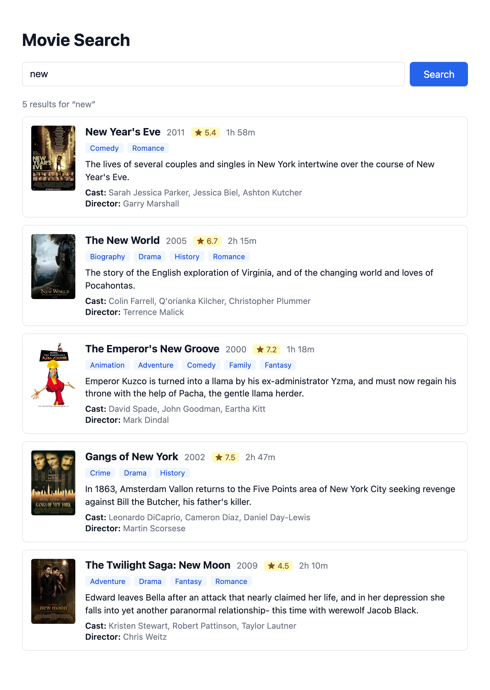
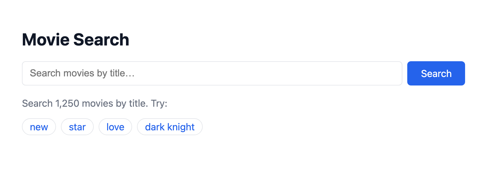
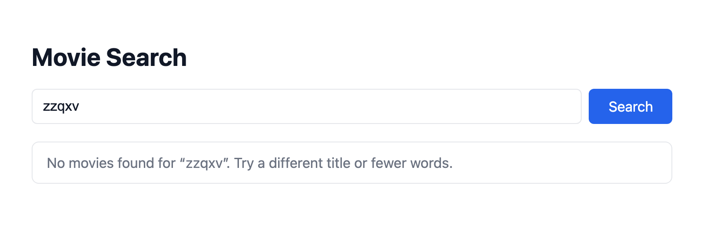
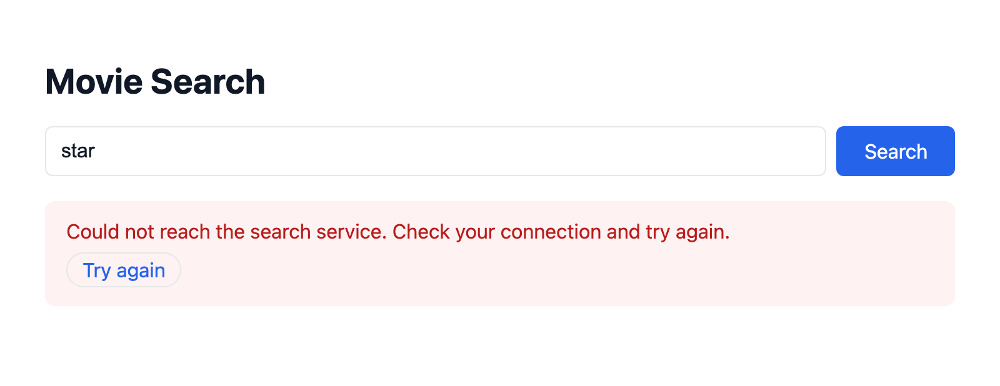
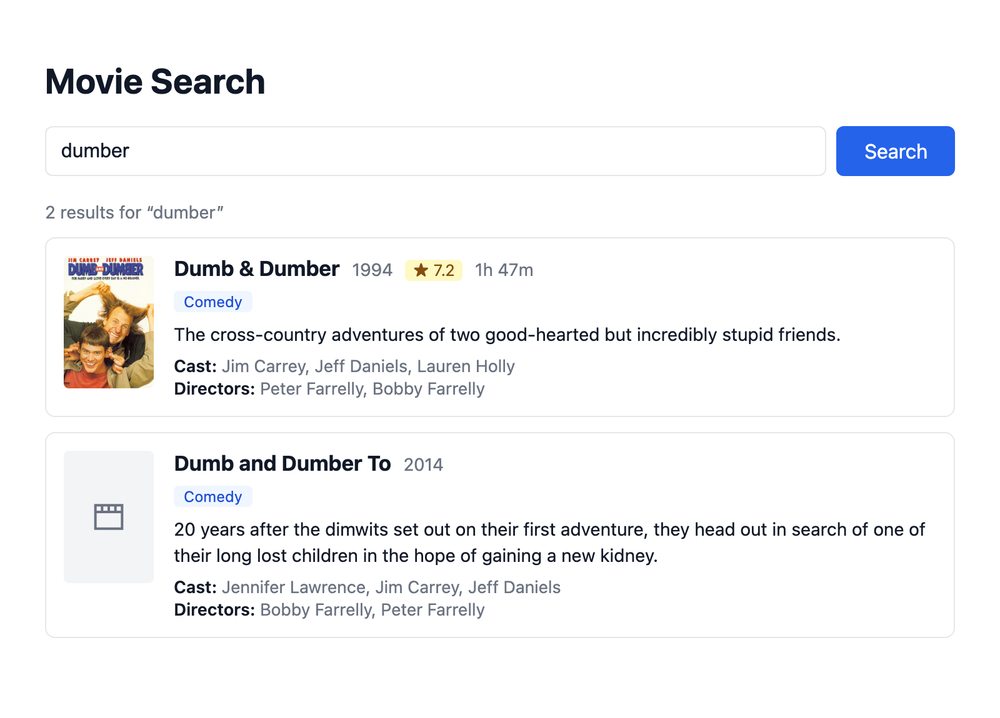

# Movie Keyword Search on AWS (Homework 0-4)

A keyword search engine for movies. A React page calls an API Gateway endpoint (`GET /search?q=`). The endpoint triggers a Python Lambda, which runs a `match` query against an Amazon OpenSearch domain. All AWS resources are defined in **one AWS CDK stack** (Python).



| Start | Loading | No results | Request failed | Missing fields |
| --- | --- | --- | --- | --- |
|  |  |  |  |  |

All screenshots come from the deployed stack (us-east-2) with all 1,250 sample movies loaded. The "Request failed" shot simulates a network failure by blocking the API request in the browser. The "Missing fields" shot shows a movie with no poster, rating or runtime, so the placeholder poster appears and those fields are hidden.

```
React (Vite)  ──GET /search?q=──▶  API Gateway (REST, CORS)  ──▶  Lambda (Python 3.12)
                                                                     │  SigV4 (requests-aws4auth)
                                                                     ▼
                                                        OpenSearch domain · index "movies"
                                                        1 × t3.small.search · 10 GB EBS
```

## Requirements checklist

**Infrastructure (AWS CDK)** ([`infra/movie_search/stack.py`](infra/movie_search/stack.py))
- [x] One stack, `MovieSearchStack`, contains every resource.
- [x] OpenSearch domain: 1 data node, `t3.small.search`, 10 GB gp3 EBS, OpenSearch 2.19. HTTPS, node-to-node encryption and encryption at rest are enabled.
- [x] Lambda function on **Python 3.12**. Its role may only call `es:ESHttpGet/Post` on `movies/_search`.
- [x] API Gateway REST API with a single **`GET /search`** method. CORS is enabled through preflight `OPTIONS` responses plus CORS headers on every Lambda response.
- [x] The OpenSearch endpoint reaches the Lambda through the **`OPENSEARCH_ENDPOINT` environment variable**.

**Data & indexing** ([`seed/`](seed))
- [x] Index **`movies`** with an explicit mapping ([`seed/movies_index.json`](seed/movies_index.json)):
  - `title`: `text`, so it is full-text searchable. A `title.keyword` sub-field is added for exact matching.
  - `plot`: `text` with `"index": false`, so it is stored and returned but not searchable.
  - `rating` (`float`), `year` (`integer`), `genres`, `actors`, `directors` (`keyword`): stored and indexed.
  - `dynamic: false`. The remaining fields (`image_url`, `release_date`, `running_time_secs`, `rank`) are declared but not indexed.
- [x] [`seed/seed_index.py`](seed/seed_index.py) creates the mapping, then bulk-loads **all 1,250 movies** from [`data/sample-movies.bulk`](data/sample-movies.bulk) in one bulk API request.

**Backend (Lambda)** ([`lambda/handler.py`](lambda/handler.py))
- [x] Reads `q` from `queryStringParameters`. A missing, empty or whitespace-only `q` returns **400**.
- [x] Runs a `match` query on **`title` only**.
- [x] Returns `{ "results": [...], "total": N }`.
- [x] Signs requests with **SigV4** via `requests-aws4auth`, using the Lambda role's credentials.

**Frontend (React)** ([`frontend/src`](frontend/src))
- [x] Search bar that queries on form submit.
- [x] Each result shows the poster, title, year, rating, genre tags, plot, cast and director. Runtime is also shown, as in the sample screenshot (`1h 58m`).
- [x] A loading state (spinner, disabled button) while the request is in flight.
- [x] An error message when the request fails, and a message when there are no results.

### Notes on the sample data
- **Fields can be missing.** Some movies lack `rating` (87), `running_time_secs` (88), `image_url` (27), `plot` (25), `directors` (3) or `year` (1). The UI skips any missing field, and a missing or broken poster falls back to a placeholder.
- **Mixed `rating` types.** `rating` mixes integers and decimals, so the mapping sets it to `float` explicitly rather than relying on dynamic mapping.
- **No trailing newline.** The bulk file lacks the trailing newline the bulk API requires. The seed script validates every line, drops the legacy `"type": "add"` field, and appends the newline.

## Project structure

```
infra/                 AWS CDK app (Python)
  app.py               entry point; builds the Lambda package, then defines the stack
  movie_search/stack.py   OpenSearch domain + Lambda + REST API
  movie_search/bundle.py  Docker-free Lambda packaging (pip --platform manylinux)
lambda/handler.py      search handler (requests + requests-aws4auth)
seed/seed_index.py     creates the index mapping, then bulk-loads the movies
seed/movies_index.json index settings and mapping
frontend/              React + Vite UI
data/sample-movies.bulk  course sample data (1,250 movies, bulk API format)
tests/                 pytest: handler, seed script, CDK template assertions
```

## Deploy and run

Requirements:
- Python 3.12+ and Node.js 22+.
- The AWS CLI, AWS CDK v2 (`npm i -g aws-cdk`) and AWS credentials. For credentials, `aws login` works; `boto3[crt]` in `requirements-dev.txt` lets the seed script use them.
- No Docker. The Lambda package is built with `pip --platform`.

```bash
# 1. Python environment (CDK app, seed script, tests)
python3.12 -m venv .venv && source .venv/bin/activate
pip install -r requirements-dev.txt

# 2. Deploy the stack (the OpenSearch domain takes ~15–20 minutes)
cd infra
cdk bootstrap                      # once per account/region
cdk deploy --outputs-file ../.cdk-outputs.json
cd ..

# 3. Create the index and load the movies (reads the endpoint from the stack outputs)
python seed/seed_index.py --recreate

# 4. Frontend
cd frontend
cp .env.example .env               # set VITE_API_URL to the ApiUrl stack output
npm install
npm run dev                        # http://localhost:5173
```

The search page also accepts the query in the URL, for example `http://localhost:5173/?q=new`.

To remove everything (the OpenSearch domain costs about $0.04/hour):

```bash
cd infra && cdk destroy
```

## API

`GET {ApiUrl}search?q=<keywords>[&size=<1-50>]`

| Case | Status | Body |
| --- | --- | --- |
| Matches found | 200 | `{"results": [{"id", "title", "year", "rating", "genres", "actors", "directors", "plot", "image_url", "running_time_secs", "release_date", "rank", "score"}], "total": N}` |
| No matches | 200 | `{"results": [], "total": 0}` |
| `q` missing or empty | 400 | `{"error": "Query parameter 'q' is required and cannot be empty."}` |
| OpenSearch unreachable or erroring | 502 | `{"error": "..."}` |

`total` is the full number of matches. `results` holds the top `size` matches (default 20).

These are the results of running each check against the deployed API:

```text
GET /search?q=new        → 200, total 5: New Year's Eve, The New World, The Emperor's New Groove,
                                         Gangs of New York, The Twilight Saga: New Moon
GET /search              → 400 {"error": "Query parameter 'q' is required and cannot be empty."}
GET /search?q=%20%20     → 400 (whitespace only)
GET /search?q=zzqxv      → 200 {"results": [], "total": 0}
GET /search?q=llama      → 200, total 0: "llama" appears only in a plot, and plot is not indexed
OPTIONS /search          → 204 with Access-Control-Allow-Origin: *
POST /search             → 403: only GET is exposed
```

## Tests

```bash
source .venv/bin/activate && pytest     # handler, seed script and CDK template tests
cd frontend && npm test                 # display helpers (runtime, rating, URL building)
```

- **Python tests:** cover the 400 cases, the `match` query on `title`, the response shape, CORS headers, error handling, the mapping, the bulk file and its trailing newline, and the stack (t3.small, 10 GB, Python 3.12, endpoint env var, `GET /search`, CORS).
- **Frontend tests:** cover runtime and rating formatting, name joining, and building the search URL.
