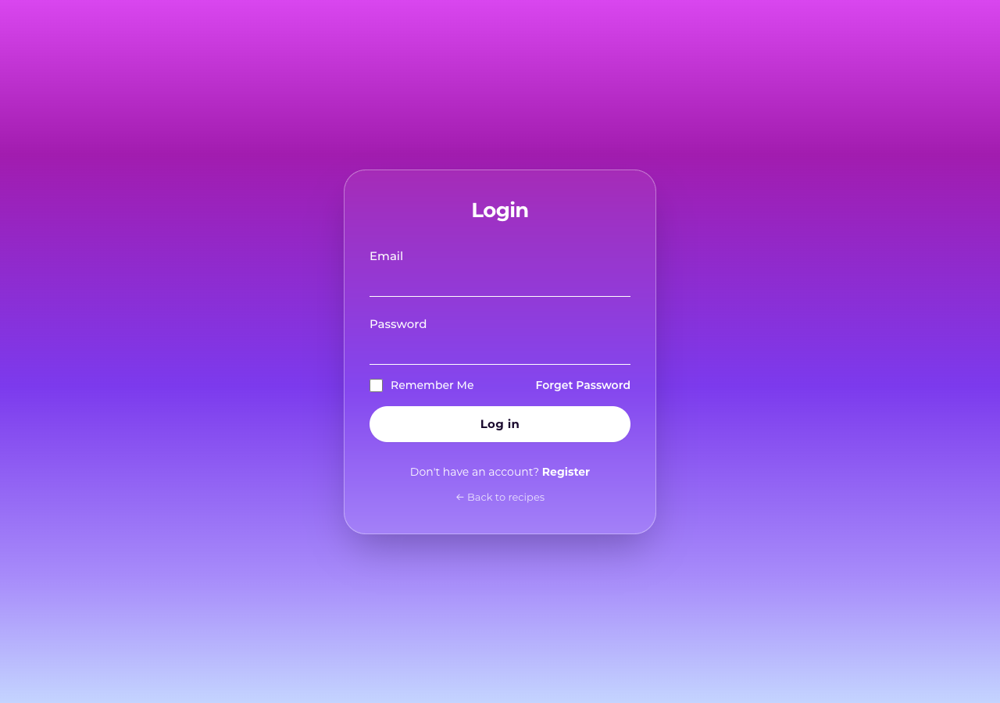
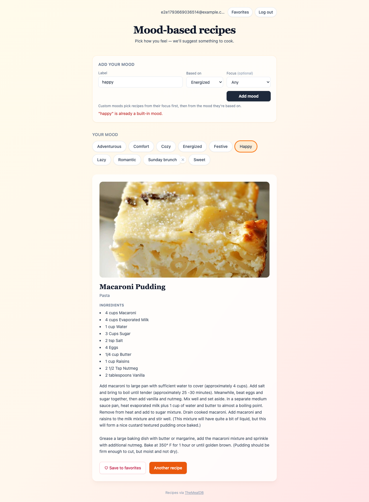
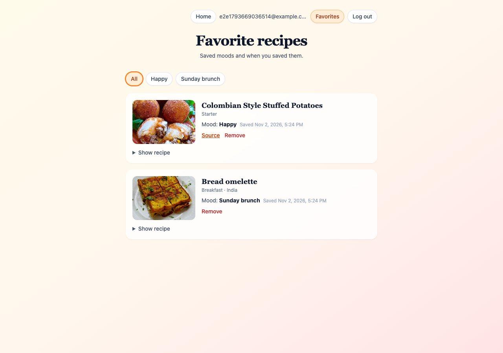

# Mood Recipes — Accounts, Favorites & Custom Moods (Homework 0-2)

This homework extends the course's [Mood Recipe starter app](https://github.com/uscodingnerd/ai-tools/tree/main/cursor/mood-recipes-example) with user accounts, favorite recipes stored per user, and user-defined moods. The stack is FastAPI, SQLAlchemy + SQLite, bcrypt, and a static Tailwind UI. Recipes come from [TheMealDB](https://www.themealdb.com/).

| Login (from the provided mock-up) | Home | Favorites |
| --- | --- | --- |
|  |  |  |

## Features

**1. User authentication**
- Register, log in, log out, forgot password, and reset password pages, styled after the provided login image.
- Passwords are hashed with **bcrypt** (cost 12) and never stored in plain text.
- Sessions use random tokens. Only their SHA-256 hash is stored, and the cookie is `HttpOnly` with `SameSite=Lax`.
- **Remember me** sets a 30-day persistent cookie. Without it, the cookie lasts only for the browser session (12 hours max on the server).
- Forgot password creates a **single-use, 30-minute** reset link, stored hashed. Only the newest link works, and resetting the password signs the user out on every device.
- The forgot-password form doesn't reveal whether an account exists. Five failed logins lock the account for 15 minutes.

**2. Save favorite recipes**
- Logged-in users can click **♡ Save to favorites** on any recipe.
- The server looks the recipe up on TheMealDB itself and stores a copy of it, linked to that user in SQLite.
- Saving the same recipe under another mood adds that mood to the existing favorite instead of creating a duplicate.

**3. Favorites page (`favorites.html`)**
- Each favorite recipe shows **every mood it was saved under** and when it was saved.
- You can filter by mood, expand the full recipe, open the video or source link, and remove a mood or the whole favorite.

**4. Custom moods**
- Under **Add your mood**, give the mood a label, pick a built-in mood it is *based on*, and optionally choose a **focus** (a TheMealDB category or cuisine).
- Recipe selection for a custom mood tries the focus first, then falls back to the base mood's recipe pool.
- Custom moods are private to each user and can be deleted. Favorites keep the mood's label even after it's deleted.

**Starter fixes**
- The starter repo's `app.py`, `recipe_service.py` and `requirements.txt` held each other's contents, so they've been put back in the right files.
- The **Sweet** button returned HTTP 400 because the backend had no such mood.
- The empty-pool fallback called `_random_meal_any` with the wrong arguments.
- TheMealDB filter lookups are now cached, so each click no longer re-downloads every category.
- Four more built-in moods were added: Sweet, Festive, Lazy, and Romantic.

The step-by-step development plan is in [PLAN.md](PLAN.md), and each feature was committed separately.

## Running locally

Requires Python 3.10+.

```bash
python3 -m venv .venv && source .venv/bin/activate
pip install -r requirements-dev.txt
uvicorn app:app --reload          # http://localhost:8000
pytest                            # 25 API tests (TheMealDB is mocked)
```

The database (`mood_recipes.db`) is created automatically on first start.

### Password-reset email

Without an SMTP server, the reset link is written to the server log. In dev mode it is also shown on the forgot-password page, so the whole flow works locally. To send real emails, set these environment variables:

| Variable | Purpose |
| --- | --- |
| `SMTP_HOST`, `SMTP_PORT`, `SMTP_USER`, `SMTP_PASSWORD`, `SMTP_FROM` | Send reset links by email (STARTTLS) |
| `BASE_URL` | Public URL used in reset links (default `http://localhost:8000`) |
| `DEV_SHOW_RESET_LINK=0` | Never show reset links in the browser. **Set this in production.** |
| `COOKIE_SECURE=1` | Mark the session cookie `Secure` when serving over HTTPS |
| `DATABASE_URL` | Any SQLAlchemy URL (default: SQLite file next to `app.py`) |

## Project structure

```
app.py              FastAPI app, /api/recipe (built-in + custom moods), static files
auth.py             register / login / logout / me / forgot / reset, session dependency
moods.py            built-in + custom moods, mood → recipe filter resolution
favorites.py        save / list / untag / remove favorites
recipe_service.py   TheMealDB client, mood filters, caching
models.py, db.py    SQLAlchemy models and engine
security.py         bcrypt hashing, token helpers
config.py           settings from environment variables
static/             index, login, register, forgot/reset password, favorites pages
tests/              pytest suite
```

## API

| Method & path | Description |
| --- | --- |
| `POST /api/auth/register` `{email, password}` | Create an account and log in |
| `POST /api/auth/login` `{email, password, remember}` | Log in |
| `POST /api/auth/logout` | Log out |
| `GET /api/auth/me` | Current user, or `null` |
| `POST /api/auth/forgot` `{email}` | Send a reset link |
| `POST /api/auth/reset/check` `{token}` | Check whether a reset link is still valid |
| `POST /api/auth/reset` `{token, password}` | Set a new password |
| `GET /api/moods` | Built-in moods, your custom moods, and the focus options |
| `POST /api/moods` `{label, base_mood, focus_type?, focus_value?}` | Add a custom mood |
| `DELETE /api/moods/{id}` | Delete a custom mood |
| `GET /api/recipe?mood=<slug or custom-id>&exclude=<ids>` | Random recipe for a mood |
| `GET /api/favorites` | Your favorites, each with its moods |
| `GET /api/favorites/status?meal_id=` | Whether a recipe is saved, and under which moods |
| `POST /api/favorites` `{meal_id, mood}` | Save a recipe under a mood |
| `DELETE /api/favorites/{id}` | Remove a favorite |
| `DELETE /api/favorites/{id}/moods/{mood_key}` | Remove one mood from a favorite |
