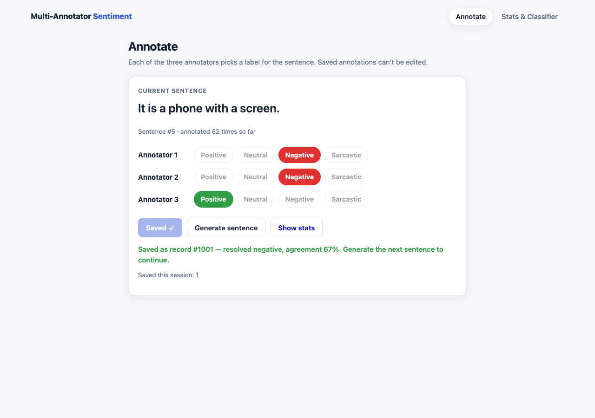
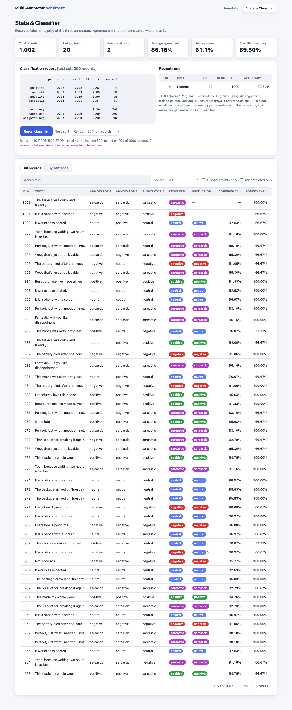
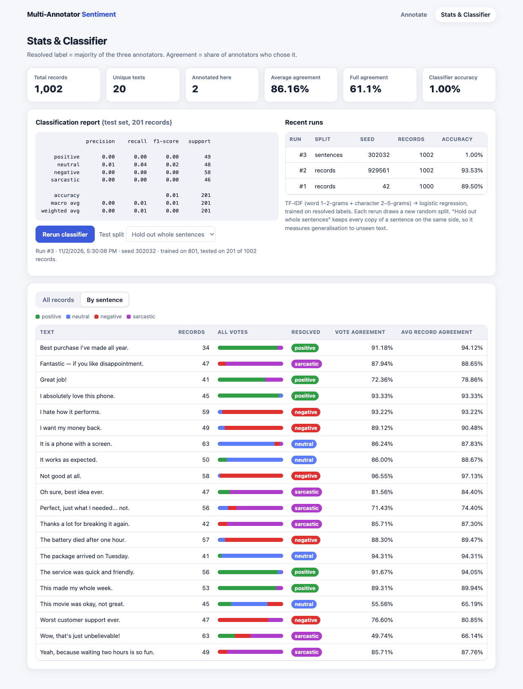

# Multi-Annotator Sentiment Workflow (Homework 0-3)

This app runs a three-annotator sentiment labelling workflow. You import the dataset into SQLite, annotate random sentences (each saved record is immutable), and review the resolved labels and agreement. A classifier is trained on the saved annotations, and you can rerun it at any time.

The stack is FastAPI, SQLite (`sqlite3`), scikit-learn, and a plain HTML/JS frontend.

| Annotate | Stats & Classifier | By sentence |
| --- | --- | --- |
|  |  |  |

## Requirements

**1. Import the dataset**
- `import_data.py` loads `multi_annotator_dataset_list.csv` into SQLite. The CSV columns are `id`, `text`, `annotations`, where `annotations` is a JSON list of three labels.
- Labels are normalised, and malformed rows are reported and skipped.
- Importing is idempotent, so re-running it never changes existing records.
- On first start the app imports the dataset automatically.

> **About the data:** the official `multi_annotator_dataset_list.csv` wasn't available when this was built. This repo therefore includes a **synthetic stand-in** in the same format, `data/sample_multi_annotator_dataset.csv`: 1,000 records over 20 sentences with simulated annotator noise, generated by `scripts/make_sample_dataset.py`.
>
> To use the real data, put the file at `data/multi_annotator_dataset_list.csv`. The app and `import_data.py` use it in preference to the sample. When switching, delete `annotations.db` first so only the real data is loaded.

**2. Annotator UI**
- The page shows a random sentence, avoiding the one you just saw.
- Annotators 1–3 each pick **Positive, Neutral, Negative or Sarcastic**.
- **Save annotation** stays disabled until all three annotators have chosen a label. The server also rejects anything other than three valid labels.
- Saved annotations are **immutable**:
  - the record locks in the UI;
  - each drawn sentence carries a one-time `client_key`, so a double submit returns HTTP 409;
  - the API has no update or delete endpoints;
  - SQLite triggers reject every `UPDATE` and `DELETE` on the `annotations` table.

**3. Stats & classifier**
- Every record is listed with its three votes, **resolved label**, **agreement %**, prediction, and confidence. You can search, filter by source, show only disagreements or mispredictions, sort, and page through results.
- A "By sentence" view pools all votes for each unique sentence.
- Summary tiles show: total records, unique texts, records annotated in the app, average agreement, full-agreement rate, and classifier accuracy.
- **Classifier:**
  - TF-IDF features (word 1–2-grams plus character 2–5-grams) feed a balanced logistic regression, trained on the resolved labels.
  - The page shows the scikit-learn `classification_report` for the held-out test set.
- **Rerun classifier** retrains on all current annotations with a new random split. Every run, and the per-record predictions from it, is stored in SQLite. The page lists recent runs and flags annotations added since the last run.

### How labels are resolved

- **Resolved label:** the label chosen by the majority of the three annotators.
- **Agreement:** `votes for the resolved label / 3`, so 100%, 67% or 33%.
- **Three-way split (1-1-1):** the tie goes to whichever of the tied labels this sentence most often received across all its records. If that is still tied, a fixed label order decides, so results are deterministic.

### Two ways to evaluate

| Test split | What it measures |
| --- | --- |
| **Random 20% of records** (default, like the sample screenshot) | The same sentences appear in both train and test, so accuracy (~90% on the sample) mostly shows how *consistent the labels* are for sentences the model has seen. |
| **Hold out whole sentences** | Every copy of a sentence stays on the same side of the split, so this tests *generalisation to unseen text*. With only 20 distinct sentences, accuracy here is near zero, which is an honest result for a dataset this small. |

## Running locally

Requires Python 3.10+.

```bash
python3 -m venv .venv && source .venv/bin/activate
pip install -r requirements-dev.txt
python import_data.py            # optional: the app also imports on first start
uvicorn app:app --reload         # http://localhost:8000
pytest                           # 17 tests
```

Set `ANNOTATOR_DB=/path/to.db` to use a different database file.

## Project structure

```
app.py                    FastAPI app: sentence, annotation, stats and classifier endpoints
import_data.py            CSV → SQLite importer (CLI)
db.py                     schema, immutability triggers, connection helper
analysis.py               label resolution, agreement, classifier training and storage
scripts/make_sample_dataset.py   generator for the synthetic sample CSV
static/                   annotator page (index.html) and stats page (stats.html)
data/                     datasets
tests/                    importer, immutability, resolution, classifier and API tests
```

## API

| Method & path | Description |
| --- | --- |
| `GET /api/sentence/random?exclude=<id>` | Random sentence from the pool |
| `POST /api/annotations` `{sentence_id, labels: [a1, a2, a3], client_key}` | Save one immutable record |
| `GET /api/stats` | Summary, every record with its prediction, per-sentence view, latest report, run history |
| `POST /api/classifier/run` `{split: "records" \| "sentences", seed?}` | Retrain and store a new run |
