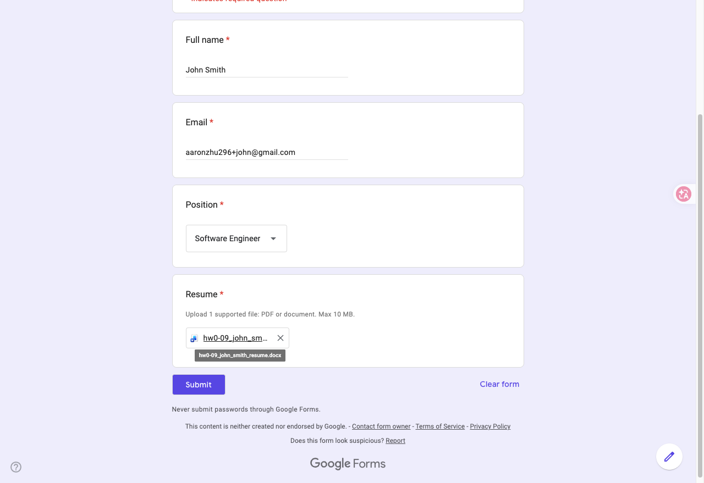

# SmartHire AI: Resume Screening & Candidate Ranking (Homework 0-9)

An end-to-end resume screening pipeline:

1. A candidate applies through a **Google Form**.
2. **Zapier** extracts the resume text and loads the job requirements from **Amazon DynamoDB**.
3. An **LLM judge** assesses the candidate against each requirement. Code turns that assessment into a score and an advance/reject decision.
4. The candidate is stored and ranked, and Zapier sends the **advance or rejection email**.

```
Google Form ──▶ Zapier ─────────────────────────────────────────────────────────────────▶ Gmail
 (name, email,   1 New Form Response                                                    8a advance email
  position,      2 Formatter: file ID from the Drive link                               8b rejection email
  resume file)   3 Google Drive: retrieve the uploaded file                                  ▲
                 4 Webhook POST /resumes/parse ───┐                                          │ Paths on
                 5 Webhook GET  /jobs/{position} ─┤  API Gateway (x-api-key) ─▶ Lambda (3.12) │ "decision"
                 6 LLM judge (AI by Zapier)       │                              │           │
                 7 Webhook POST /evaluations ─────┘                              ▼           │
                                                         DynamoDB JobRequirements / Candidates
```



## Requirements checklist

| Requirement | Where |
| --- | --- |
| Resume intake via Google Forms | Form "SmartHire AI – Job Application": Full name, Email (validated), Position (dropdown), Resume (file upload, PDF/document, 10 MB) |
| Extract and process resume content | `POST /resumes/parse` ([`lambda/resume_text.py`](lambda/resume_text.py)): DOCX from its XML, PDF with pypdf, plain text |
| Job requirements stored and managed in DynamoDB | `JobRequirements` table, seeded and updated with [`seed/seed_jobs.py`](seed/seed_jobs.py) from [`seed/job_requirements.json`](seed/job_requirements.json), read with `GET /jobs/{job}` |
| LLM judge evaluates candidate fit | [`prompts/judge_prompt.md`](prompts/judge_prompt.md) |
| Structured scores and decisions | [`lambda/scoring.py`](lambda/scoring.py): weighted score 0–100, mandatory check, threshold, stored in `Candidates` and ranked (`GET /rankings/{job}`) |
| Advance/rejection emails | Zapier Paths on `decision` → Gmail, templates in [`prompts/email_templates.md`](prompts/email_templates.md) |

## Design

**The judge decides the evidence, code decides the outcome.** For each requirement, the LLM returns a status (`met`, `partial` or `not_met`) and a quoted piece of evidence. [`scoring.py`](lambda/scoring.py) then applies the weights stored with the job in DynamoDB:

- Each requirement earns credit: met = 1, partial = 0.5, not_met = 0.
- **score** = 100 × earned weight / total weight.
- A **mandatory** requirement (3+ years of relevant experience) that is not fully met means **reject**, whatever the score.
- Otherwise the candidate **advances** if score ≥ `advance_threshold` (70).

The same assessment therefore always gives the same decision. A strong score on the other requirements can never outweigh a missing mandatory one.

**Judge prompt.** The prompt is written to make the assessment hard to game:

- Every status must cite resume evidence.
- Experience counts only if it is relevant to the role. Four years of childcare does not count toward a software role.
- The degree's field matters.
- If the resume contradicts itself, the judge assesses what the resume states and records the conflict as a **red flag** for a recruiter to verify.
- The resume is wrapped in delimiters and treated as data, so instructions hidden in a resume are ignored and flagged.
- Personal attributes are ignored.

**Why an API between Zapier and DynamoDB.** The AWS account is a new-style AWS project account without IAM users, so it cannot create the long-lived access keys that Zapier's DynamoDB app asks for. The tables sit behind a small API instead:

- Zapier calls it through Webhooks with an API Gateway key (usage plan: 5 req/s, 1,000/day).
- The Lambda's role is the only thing that can read or write DynamoDB: read-only on jobs, read/write on candidates.

**Judge model.** The assignment names OpenAI. Its API needs prepaid credits, so this build uses **AI by Zapier** (included in the Zapier plan) for the judge step. The prompt is model-agnostic and can be pasted unchanged into Zapier's *ChatGPT (OpenAI)* action.

## Job requirements (DynamoDB)

| Software Engineer | Weight | AI Engineer | Weight |
| --- | --- | --- | --- |
| 3+ years relevant experience (**MANDATORY**) | 25 | 3+ years AI/ML engineering (**MANDATORY**) | 20 |
| BS in CS or related | 15 | BS/MS in CS, AI or related | 10 |
| Python, JavaScript or similar | 15 | Python + ML frameworks | 15 |
| SQL and databases | 15 | LLMs, prompt engineering, fine-tuning | 15 |
| Cloud (AWS/GCP/Azure) | 10 | MLOps and deployment | 10 |
| Git | 10 | Cloud ML platforms | 10 |
| Communication | 10 | Data preprocessing, feature engineering | 10 |
| | | Git / Communication | 5 / 5 |

Advance threshold: 70 for both roles.

## API

| Method and path | Purpose |
| --- | --- |
| `GET /jobs` | List roles |
| `GET /jobs/{job}` | One role by id or title (`Software%20Engineer`). The response includes `requirements_text`, formatted for the judge prompt |
| `POST /resumes/parse` | Resume → text. Accepts a multipart file (Zapier "File" field), or `file_url`, `content_base64` or `text` |
| `POST /evaluations` | `{job, candidate_name, candidate_email, assessment}` → score, decision, reason, strengths, gaps and rank. Stored in `Candidates` |
| `GET /rankings/{job}` | Candidates for a role: advanced first, then by score |

Verified against the deployed stack (us-east-2):

```text
GET  /jobs                       (no key)  → 403
GET  /jobs/Software%20Engineer             → 200, 7 requirements, experience MANDATORY (weight 25)
POST /resumes/parse  (multipart: hw0-09_john_smith_resume.docx) → 200, kind=docx, 1,369 characters
```

## Project structure

```
infra/                 CDK app (Python): DynamoDB x2, Lambda, REST API + API key + usage plan
lambda/handler.py      routes; multipart parsing; DynamoDB reads and writes; ranking
lambda/resume_text.py  DOCX / PDF / text extraction
lambda/scoring.py      assessment -> score -> decision
seed/                  job requirements and the validated seed script
prompts/               LLM judge prompt and email templates
data/resumes/          the two sample resumes
tests/                 pytest (12 tests): extraction, multipart upload, scoring rules, ranking
```

## Deploy

```bash
python3.12 -m venv .venv && source .venv/bin/activate
pip install "aws-cdk-lib>=2.200" "constructs>=10" "boto3[crt]" pypdf pytest
cd infra && cdk deploy --outputs-file ../.cdk-outputs.json && cd ..
python seed/seed_jobs.py                       # load job requirements into DynamoDB
aws apigateway get-api-key --api-key <ApiKeyId output> --include-value   # key for Zapier
pytest
```

Remove everything with `cd infra && cdk destroy`.
