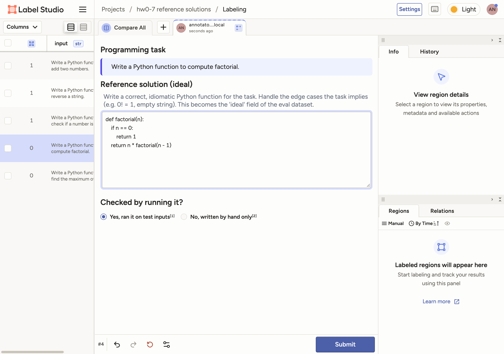

# Code Grading with LLM-as-a-Judge (Homework 0-7)

This homework builds an evaluation pipeline for model-written code:

1. Label the tasks in **Label Studio**.
2. Turn the labels into an **eval JSONL**.
3. Grade the model's answers with an **LLM judge** on a 1–5 scale, then interpret the scores.

```
hw0-07_inputs.csv ──▶ Label Studio ──▶ label_studio_export.json ─┐
 (5 tasks)            (human writes                              ├─▶ convert_to_jsonl.py ──▶ eval_dataset.jsonl
                       the reference)    hw0-07_inputs_model_    │                          {input, ideal, sampled}
                                         output.csv (sampled) ───┘                                   │
                                                                                                     ▼
                       judge/system_prompt.md + eval_config.yaml ──▶ run_eval.py ──▶ results/report.md
                                                                     (2 judges × 5 runs)   results/eval_results.json
                                                    exec_check.py (unit tests) ──▶ sanity check of the judge
```

## Results at a glance

| Task | Model answer (`sampled`) | Unit tests | Sonnet judge | Haiku judge |
| --- | --- | --- | --- | --- |
| Add two numbers | `def add(a, b): return a + b` | 5/5 | 4, 4, 4, 4, 4 | 5, 4, 5, 5, 5 |
| Reverse a string | `''.join(reversed(s))` | 5/5 | 5, 5, 5, 5, 5 | 5, 5, 5, 5, 5 |
| Check if even | `if n % 2 == 0: return True else: return False` | 6/6 | 4, 4, 4, 4, 4 | 4, 4, 4, 4, 4 |
| Factorial | `for i in range(1, n): result *= i` | **2/5** | 2, 2, 2, 2, 2 | 2, 2, 2, 2, 2 |
| Maximum of a list | `return sorted(nums)[0]` | **2/5** | 1, 1, 1, 1, 1 | 1, 1, 1, 1, 2 |

| Judge | Mean score | 95% CI | Variance (sample means) | Std | Judge std (repeat runs) | Agrees with unit tests |
| --- | --- | --- | --- | --- | --- | --- |
| `claude-sonnet-5-5` | **3.20** | [1.80, 4.40] | 2.160 | 1.470 | **0.000** | 5/5 |
| `claude-haiku-5-5` | **3.40** | [2.04, 4.72] | 2.336 | 1.528 | 0.160 | 5/5 |

Full report with every judge's reasoning: [`results/report.md`](results/report.md). Raw replies: [`results/eval_results.json`](results/eval_results.json).

---

## 1. Labeling in Label Studio



**Labeling interface** ([`labeling/label_config.xml`](labeling/label_config.xml)). Each task from `hw0-07_inputs.csv` is shown at the top. The annotator fills in two fields:

- **`ideal`**: a `TextArea` for the reference solution. It is required and allows one submission per annotation.
- **`verified`**: a required single choice, "Yes, ran it on test inputs" / "No, written by hand only". This records whether the reference was actually executed, which matters because the judge treats it as ground truth.

**Project setup and export** ([`labeling/label_studio.py`](labeling/label_studio.py)) use the Label Studio REST API:

- `setup` creates the project with this config and imports the CSV rows. Running it again does not import duplicates.
- `export` saves the standard JSON export to [`data/label_studio_export.json`](data/label_studio_export.json).

All five tasks were labelled in the Label Studio UI. Each reference solution passed the unit tests in [`data/test_cases.json`](data/test_cases.json) before it was entered, so all five are marked "Yes, ran it". The factorial reference matches the example in the assignment.

## 2. Converting to JSONL

[`convert_to_jsonl.py`](convert_to_jsonl.py) merges three files:

- `hw0-07_inputs.csv` gives `input`.
- The Label Studio export gives `ideal`, taken from the latest non-cancelled annotation of each task.
- `hw0-07_inputs_model_output.csv` gives `sampled`, matched row by row.

The script stops with an error if the row counts differ or a task has no reference. The result is [`data/eval_dataset.jsonl`](data/eval_dataset.jsonl):

```json
{"input": "Write a Python function to compute factorial.", "ideal": "def factorial(n):\n    if n == 0:\n        return 1\n    return n * factorial(n - 1)", "sampled": "def factorial(n):\n    result = 1\n    for i in range(1, n):\n        result *= i\n    return result"}
```

## 3. Evaluation

### Judge prompt

The judge prompt has two parts:

- [`judge/system_prompt.md`](judge/system_prompt.md): role, grading procedure, rubric and output format.
- [`judge/user_template.md`](judge/user_template.md): filled with `{input}`, `{ideal}` and `{sampled}` for each sample.

The scoring system from the assignment, with a concrete test for each level:

| Score | Label | Use when |
| --- | --- | --- |
| 5 | Fully correct | Correct for every valid input, including implied edge cases, with no minor issues |
| 4 | Correct, minor issues | Correct for every valid input, but has a style, clarity or efficiency issue |
| 3 | Partially correct | Right for typical inputs, wrong for an implied edge case, or solves only part of the task |
| 2 | Major issues | Wrong for many ordinary inputs, but close to correct; a small fix repairs it (e.g. an off-by-one bound) |
| 1 | Incorrect | Wrong in general, computes something else, or does not run |

The prompt is written to make grades consistent and checkable:

- **Trace before scoring.** The judge must trace the candidate by hand on a typical input, an edge case and an input that exposes off-by-one errors, and compare each result with the reference.
- **Reasoning, then score.** The reply is `{"reasoning", "score"}` with the reasoning first, so the score follows from it.
- **Explicit issue categories.** The prompt separates what counts as a wrong result, what counts as a minor issue, and what is **not** an issue. A different algorithm, missing docstrings, or not validating inputs the task never mentions are not penalised (the reference does not validate them either). Without these rules, judges tend to mark down correct code for missing input checks.
- **The reference is not the only answer.** It shows the expected behavior; a solution does not have to match its code.

### Eval config

[`eval_config.yaml`](eval_config.yaml) declares:

- the dataset;
- the grader: prompt files, the 1–5 choices, the JSON score field, and retries on invalid replies;
- two judge models;
- `runs_per_sample: 5`, so each answer is graded 5 times per judge;
- the metrics and the bootstrap settings;
- a sanity-check rule against unit tests.

[`run_eval.py`](run_eval.py) runs it and writes `results/eval_results.json` and `results/report.md`.

### Interpreting the results

- **Mean score: 3.2 (Sonnet), 3.4 (Haiku).** On average the answers are "partially correct". The average hides a split: three answers are correct (4–5) and two are clearly wrong (1–2). There is no answer in the middle, so the mean alone says little. The per-sample scores are what tell you which answers to fix.
- **Variance of 2.16 (std 1.47).** This is the spread of the per-sample mean scores. It is high because of that 3-correct / 2-wrong split. It measures how different the *answers* are, not how noisy the judge is.
- **Judge std of 0.00 (Sonnet) and 0.16 (Haiku).** This is the spread across 5 repeated runs on the same answer, which measures how much a grade depends on chance. Sonnet gave the same score every time. Haiku changed its mind twice in 25 runs: `add` got 4 once among 5s, and `find_max` got 2 once among 1s. A single run of either judge is close to its average. Haiku would still benefit from averaging a few runs.
- **95% CI of [1.8, 4.4].** The interval is wide because there are only **5 samples**. Resampling which 5 tasks are included moves the mean a lot, while the judge noise adds almost nothing. To narrow it, the eval needs **more tasks**, not more repeated runs. Roughly, the width shrinks with the square root of the number of tasks.
- **The two judges disagree on one point.** The rubric lists "several statements squeezed onto one line" as a minor issue. Sonnet applied it to the one-line `add` (score 4). Haiku mostly called it "acceptable for a trivial function" (score 5). The judges disagree on style, not on correctness: both gave identical scores to every wrong answer. This explains Haiku's slightly higher mean.

### Sanity check: is the judge right?

[`exec_check.py`](exec_check.py) runs every `sampled` answer against unit tests in an isolated subprocess. The judge never sees these tests.

- `factorial` returns `(n-1)!`: `factorial(5)` gives `24`, not `120`. It fails 3 of 5 tests.
- `find_max` returns the **minimum**: `[3, 1, 2]` gives `1`, not `3`. It fails 3 of 5 tests.
- The other three answers pass every test.

The rule "all tests pass ⇔ mean judge score ≥ 4" holds for **5/5** samples with both judges. The judges also found the same bugs as the tests on their own. For example, Sonnet: *"n=5: loop runs i=1..4, result=24… The range bound should be n+1, an off-by-one"*.

## Running it

Requires Python 3.12 and the [Claude Code CLI](https://docs.claude.com/en/docs/claude-code) (logged in), which runs the judges through [`llm.py`](llm.py). The judge prompt is the model's only system prompt, and the model has no tools.

```bash
python3.12 -m venv .venv && source .venv/bin/activate
pip install -r requirements.txt

# 1. Label (optional: the export is already in data/)
pip install label-studio && label-studio start --port 8089
#    In Label Studio: Account & Settings -> Personal Access Token
export LABEL_STUDIO_API_KEY=<token>
python labeling/label_studio.py setup     # create the project, import the 5 tasks
#    ... label every task in the UI ...
python labeling/label_studio.py export

# 2. Build the dataset
python convert_to_jsonl.py

# 3. Evaluate
python exec_check.py                      # unit tests for ideal and sampled
python run_eval.py                        # LLM judge -> results/report.md
pytest                                    # 6 unit tests for the pipeline
```
