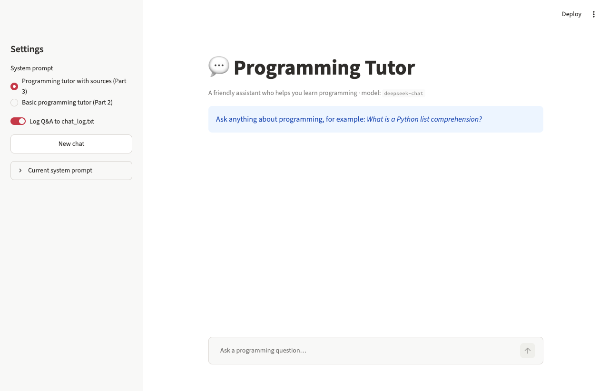
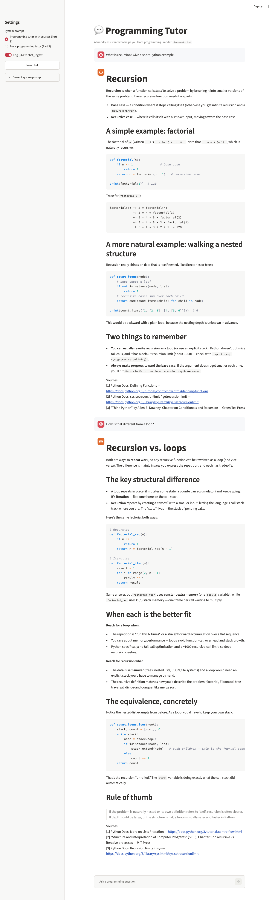

# HW1-1: Programming Tutor Chatbot

A chatbot that helps people learn programming, built in four steps: a one-shot API call, a command-line chatbot with conversation history, a system prompt that cites sources plus Q&A logging, and a Streamlit web UI.

All of it uses the OpenAI Python SDK and the Chat Completions API (`client.chat.completions.create`). The client reads its key, base URL and model from `.env`, so it works with OpenAI or any OpenAI-compatible endpoint. The runs shown below used DeepSeek (`deepseek-chat`). To use OpenAI instead, set `OPENAI_API_KEY=sk-...`, remove `OPENAI_BASE_URL`, and set `OPENAI_MODEL=gpt-4o-mini`.

| Part | File | What it does |
|---|---|---|
| 1 | `part1_hello.py` | Sends "What is the capital of France?" and prints the reply |
| 2 | `part2_chatbot.py` | CLI chatbot with multi-turn history and the assignment's system prompt |
| 3 | `part3_chatbot.py` | Same chatbot with a source-citing prompt; every Q&A pair is appended to `chat_log.txt` |
| 4 | `app.py` | Streamlit web UI: type a message, see the reply, keep chatting |
| shared | `chatbot.py`, `llm_client.py` | `ChatSession` (history, logging), prompts, client setup |

## Setup

```bash
python3 -m venv .venv
.venv/bin/pip install -r requirements.txt
cp .env.example .env        # then put your API key in .env
```

## Running

```bash
.venv/bin/python part1_hello.py
.venv/bin/python part2_chatbot.py       # /reset clears the history, /quit exits
.venv/bin/python part3_chatbot.py
.venv/bin/streamlit run app.py          # opens http://localhost:8501
.venv/bin/python -m pytest              # unit tests, no API key needed
```

## Part 1: First API call

```
Prompt:   What is the capital of France?
Response: The capital of France is **Paris**.
```

## Part 2: Command-line chatbot

`ChatSession` keeps the whole conversation in `messages`: the system prompt first, then alternating user and assistant turns. Every request sends the full list, which is how the model knows what "that" refers to in a follow-up question. If a request fails, the user turn is removed again, so a network error does not leave a question without an answer in the history.

The system prompt is exactly the one from the assignment:

```
You are a friendly assistant who helps users learn programming.
```

Excerpt from [docs/part2_transcript.txt](docs/part2_transcript.txt). The third question only makes sense if the model remembers the second:

```
You: Show me one that keeps only the even numbers from 1 to 10.

Assistant: ...
evens = [x for x in range(1, 11) if x % 2 == 0]
...

You: How would I write that same thing with a normal for loop?

Assistant: # Even Numbers from 1 to 10 with a Normal `for` Loop
evens = []
for x in range(1, 11):
    if x % 2 == 0:
        evens.append(x)
...
```

## Part 3: Prompt engineering and logging

### Citing sources

The Part 3 prompt keeps the original sentence and adds rules for answering and for sources. The assignment allows real or fictional sources. The prompt asks for real ones first and makes the model label any made-up source as `(fictional example)`, so a learner never mistakes an invented reference for a real one. A fixed `[n] Title — URL` format plus a short example keeps the output consistent from answer to answer.

```
You are a friendly assistant who helps users learn programming.

How to answer:
- Explain concepts clearly for a learner. Use short code examples when they help, and keep them correct and runnable.
- Build on earlier questions in this conversation instead of repeating yourself.

Citing sources:
- End every answer with a "Sources" section that lists 1 to 3 sources supporting it.
- Prefer real, authoritative sources: official documentation (for example docs.python.org, developer.mozilla.org), well-known books, or standards. Give the title and, when you know it, the URL.
- Never present an invented source as real. If you cannot point to a real source you are confident exists, you may give an illustrative one, but label it "(fictional example)".
- Format each source on its own line as: [n] Title — URL or publisher.

Example of the ending:
Sources:
[1] The Python Tutorial: More Control Flow Tools — https://docs.python.org/3/tutorial/controlflow.html
[2] "Learning Python" by Mark Lutz — O'Reilly Media
```

Every answer in the test run ended with a Sources list in this format, and the URLs point to real docs.python.org pages ([docs/part3_transcript.txt](docs/part3_transcript.txt)):

```
You: When should I pick the second one?
...
Sources:
[1] Python Documentation: Data Structures (tuples and sequence unpacking) — https://docs.python.org/3/tutorial/datastructures.html
[2] Python Documentation: collections.namedtuple — https://docs.python.org/3/library/collections.html#collections.namedtuple
[3] "Fluent Python" by Luciano Ramalho — O'Reilly Media
```

### Logging to chat_log.txt

`log_exchange(question, answer, path)` in `chatbot.py` appends one entry per exchange, as UTF-8, with a timestamp and a separator line:

```
[2026-11-20T16:51:23-08:00]
Q: What is the difference between a list and a tuple in Python?
A: # Lists vs. Tuples in Python
...
------------------------------------------------------------
```

`ChatSession` calls it after each successful answer when it has a `log_path`. Part 3 and the web UI log; Part 2 does not. `chat_log.txt` is gitignored. [docs/chat_log_sample.txt](docs/chat_log_sample.txt) is a copy from the test runs (two CLI questions and two web questions).

## Part 4: Web interface

`app.py` uses `st.chat_input` and `st.chat_message`. The `ChatSession` is stored in `st.session_state`, so the history survives the rerun Streamlit does on every message, and the chat continues in the browser. The sidebar lets you switch between the Part 3 and Part 2 prompts, turn logging on or off, start a new chat, and view the active system prompt.



Two-turn conversation; the second question ("How is that different from a loop?") builds on the first:



## Tests

`tests/test_chatbot.py` uses a fake client, so no key or network is needed. It checks that:
- the Part 2 prompt matches the assignment;
- the full history is sent with each request;
- `/reset` keeps only the system prompt;
- a failed request leaves the history unchanged;
- the citation prompt asks for labelled sources;
- each exchange is appended to the log, including multiline and Unicode answers.

```
7 passed
```
